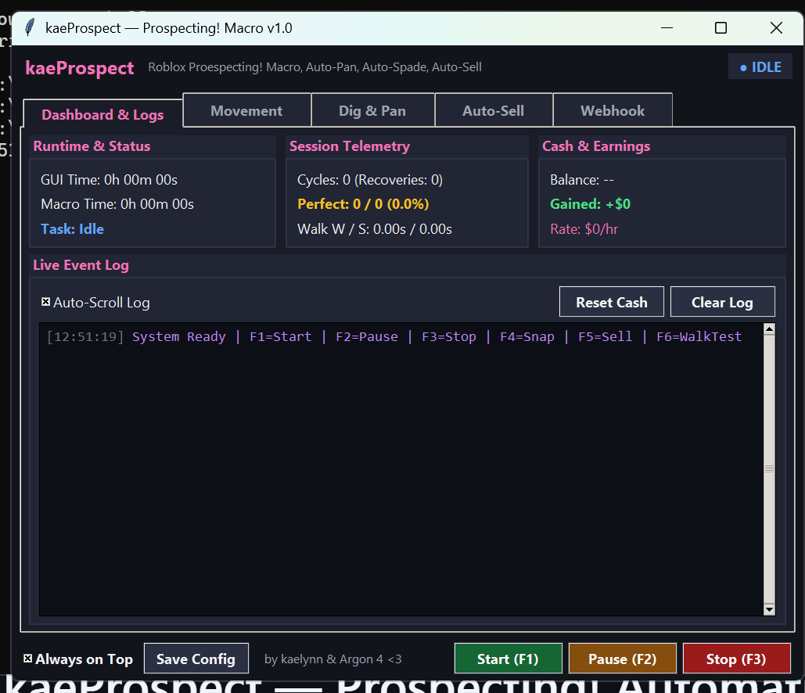
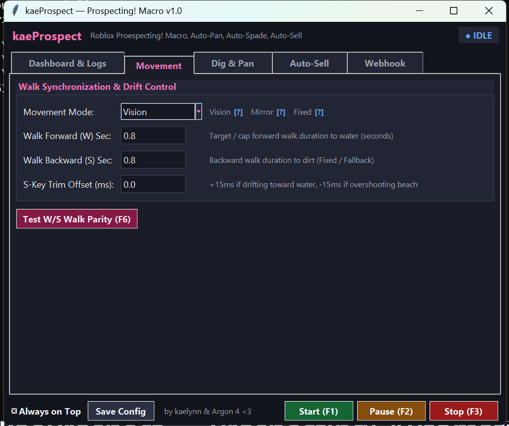
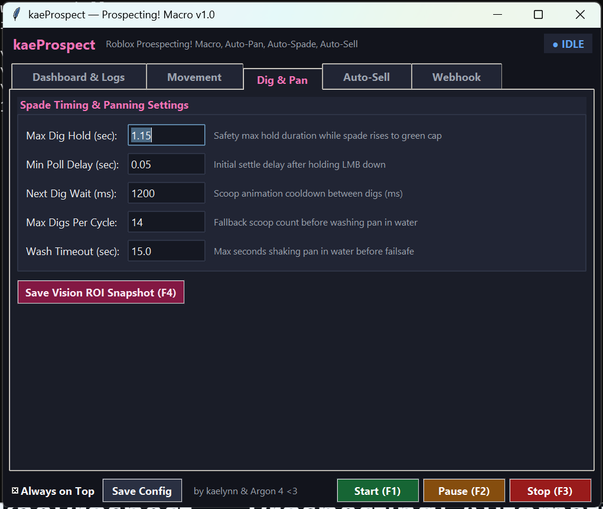
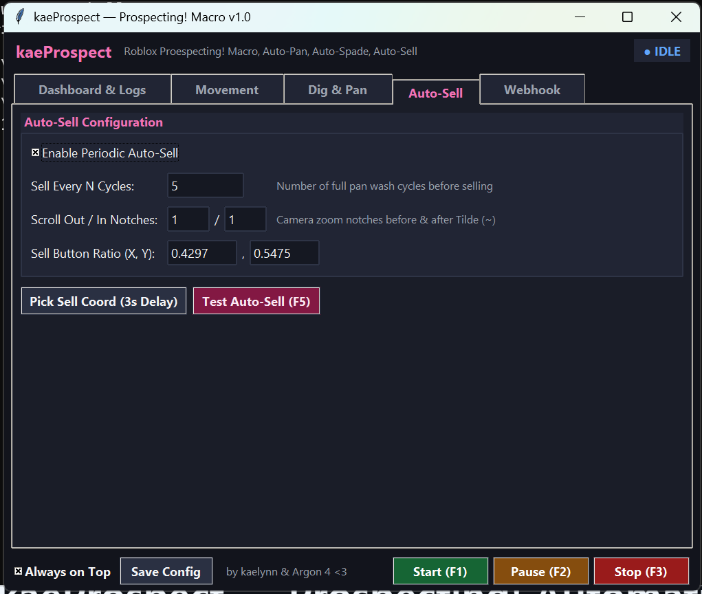
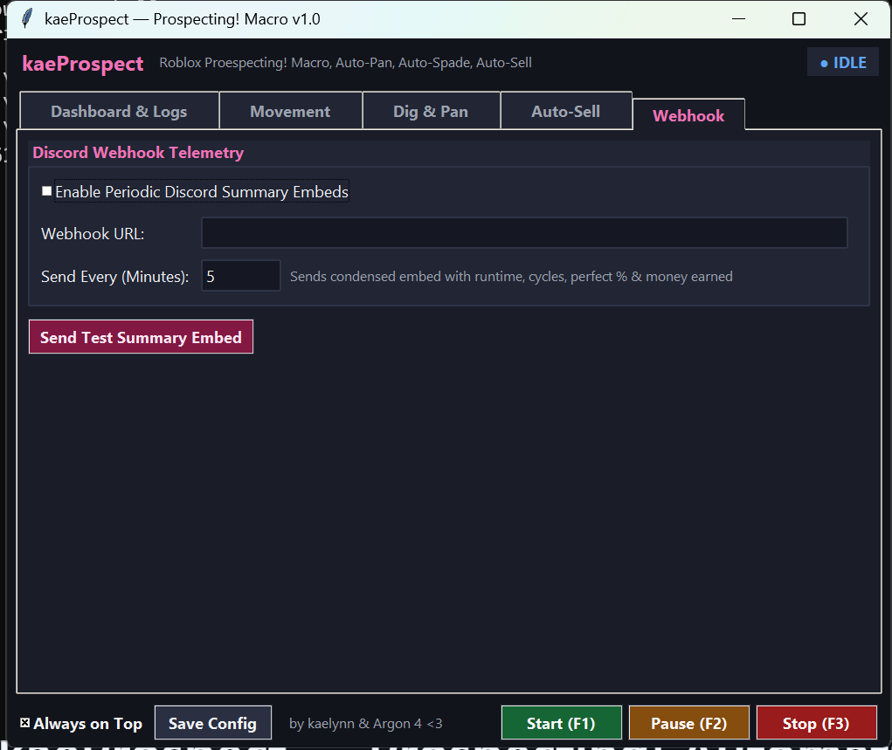
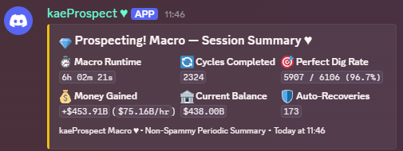

# kaeProspect — Prospecting! Automation Macro (v1.1)

[](https://www.roblox.com/games/129827112113663/Prospecting)
[]()

> [!CAUTION]
> ### ⚠️ SECURITY WARNING — BEWARE OF CLOSED-SOURCE MACROS
> **BE WARY OF OTHER MACROS (SUCH AS REDISTS of ORNATE) THAT DO NOT PROVIDE SOURCE CODE. NEVER RUN OBFUSCATED CODE OR COMPILED BINARIES (`.exe`) YOU DO NOT FULLY TRUST!**
> During research for this project, multiple malicious uploads disguised as *Prospecting!* macros were found circulating online. `kaeProspect` is distributed strictly as a single, human-readable `.py` file so you can inspect every line yourself before running it.
>

A Python automation macro for the Roblox game [*Prospecting!*](https://www.roblox.com/games/129827112113663/Prospecting). It replicates the core digging and panning loop without the in-game auto-pan debuffs, using screen-space vision to time spade releases, detect prompts, recover from shoreline drift, and track session earnings.

> **Credits:** Created by **kaelynn** & **Argon 4 (Antigravity)** for public community release.

---

## Video Showcase

<a href="https://youtu.be/V2zM7D6ncGg">
  
</a>

*Click the thumbnail above or watch directly on YouTube: **[https://youtu.be/V2zM7D6ncGg](https://youtu.be/V2zM7D6ncGg)***

---

## Interface & Screenshots

| Main Page (Dashboard & Logs) | Movement Page |
| :---: | :---: |
|  |  |
| Live runtime, cycle counts, perfect dig rate, cash tracker & color logs | `Vision`, `Mirror`, or `Fixed` modes with `W`/`S` parity & drift trim |

| Dig & Pan Settings | Auto-Sell Settings |
| :---: | :---: |
|  |  |
| Spade hold/release timing, cooldowns, max scoops & wash timeouts | Periodic backpack selling, zoom notches & 3s coordinate picker |

| Webhook Settings | Discord Summary Embed |
| :---: | :---: |
|  |  |
| Configurable interval & one-click test embed sender | Clean summary embeds in Discord (example has invalid OCR, should be fixed)|

---

## Game Policy & Safety

* **Macro Compliance:** Macros are permitted by the developers of *Prospecting!*.
* **Client Integrity:** Uses standard Windows `SendInput` events and screen capture (`mss`). It does not read/write process memory, inject DLLs, or modify the Roblox client.
* **Security Reminder:** Always inspect the source code of any macro before running it on your machine.

---

## System Requirements

* **OS:** Windows 10 or 11 (64-bit)
* **Python:** Python 3.10+ (64-bit)
* **Display:** Run Roblox in **Windowed** or **Maximized Windowed** mode on your **Primary Monitor**.
  * Default vision bounds are calibrated at **`2560x1440` with 100% Windows Display Scaling**, and a built-in **`2560x1440` (150% Windows Scaling)** preset is included directly in the HUD (plus [`prospecting_settings_1440p_150.json`](prospecting_settings_1440p_150.json)).
  * If you use a different resolution (e.g., `1920x1080`) or Windows scaling percentage, use the **Bounds & Keys** tab in the HUD to switch presets, drag/resize regions interactively on screen, or edit each region's `X`, `Y`, `Height`, and `Length`, and click **Test** on individual regions or **Test All Bounds (`F4`)** to highlight the regions directly over Roblox and save `debug_vision.png`.

---

## Features

* **Spade Minigame Vision:** Tracks the moving slider bar and releases LMB at the top green target zone.
* **Three Movement Modes:**
  * **Vision (Default):** Watches on-screen interaction prompts (`Collect Deposit` vs. `Pan`/`Shake`) to stop at water and dirt automatically.
  * **Mirror:** Stops on the water prompt walking forward (`W`) and matches that exact duration walking back (`S`).
  * **Fixed:** Uses static walk timings as a failsafe.
* **Debounced Alert Recovery:**
  * Steps back toward dirt (`S`) if *"Not enough sand!"* appears.
  * Steps forward into water (`W`) if *"Your pan is full!"* appears while washing.
* **Auto-Sell Routine:** Periodically zooms out, opens the backpack (`~`), clicks your configured Sell Target coordinate, and resumes farming.
* **Bounds & Keys Page:**
  * Modify `X`, `Y`, `Height`, and `Length` (normalized client ratios `0.0000`–`1.0000`) for all 7 regions (`Dig Target`, `Pan Full`, `Pan Empty`, `Prompt`, `Alert OCR`, `Money OCR`, and `Sell Target`) in one unified tab.
  * **One-Click Display Scale Presets:** Switch instantly between **Reset 1440p 100% (Default)** and **Load 1440p 150% Preset** buttons (or copy [`prospecting_settings_1440p_150.json`](prospecting_settings_1440p_150.json)).
  * **Interactive On-Screen Bounds Editor:** Click **Drag** on any region row, or click **Interactive Bounds Editor (Move / Resize All)** to open a full-client interactive canvas directly over Roblox where you can drag boxes to move them, drag 8-point corner/edge handles to resize them, or click-and-drag to draw new bounding boxes with real-time coordinate feedback.
  * Click **Test** on any individual region (or **Test All Bounds**) to flash a live transparent bounding-box overlay directly over the Roblox window and log real-time detector feedback.
  * Rebind global hotkeys (`Start`, `Pause / Resume`, `Stop`, `Test All Bounds`) via dropdown or one-click key listener.
* **Cash OCR & Discord Webhooks:** Tracks current balance (both abbreviated `5.56B` and full comma-separated numbers), total money gained, and hourly rate, with optional periodic Discord summary embeds.

---

## Hotkeys (Configurable in *Bounds & Keys*)

| Default Key | Action | Description |
| :--- | :--- | :--- |
| **`F1`** | **Start** | Locks onto the Roblox window and starts the macro loop |
| **`F2`** | **Pause / Resume** | Pauses or resumes the macro and releases held inputs |
| **`F3`** | **Stop** | Stops execution immediately and releases all keys/clicks |
| **`F4`** | **Test All Bounds** | Flashes live bounding boxes over Roblox, logs region readings, and saves `debug_vision.png` |

*(All 4 global hotkeys can be rebound or disabled in the **Bounds & Keys** tab. Standalone **Test W/S Walk Parity** and **Test Auto-Sell Sequence** buttons are available in the **Movement** and **Auto-Sell** tabs.)*

---

## Setup & Usage

### 1. Install Dependencies

```bash
pip install opencv-python mss numpy
```

*(Optional — Required for Cash OCR & Text Alert Fallback)*:
1. Install [Tesseract-OCR for Windows](https://github.com/tesseract-ocr/tesseract) and ensure `tesseract` is on your system `PATH`.
2. Install the Python wrapper:
   ```bash
   pip install pytesseract
   ```

### 2. In-Game Setup

1. Open Roblox on your primary monitor and equip your **Pan**.
2. Stand on the dirt shoreline facing directly toward the water so `Collect Deposit` is visible.

### 3. Run the Macro

```bash
python kaeProspect.py
```

1. Adjust movement, dig timing, auto-sell, Discord webhook, or **Bounds & Keys** settings in the GUI if needed, then click **Save Config**.
2. Press **`F1`** to start farming, **`F2`** to pause, or **`F3`** to stop.

### 4. Adapting Region Bounds to Other Resolutions & Display Scales

Because Roblox UI elements scale with both resolution and Windows DPI scaling (default calibration is **`2560x1440` at `100%` Windows scale**, with a built-in **`2560x1440` at `150%` Windows scale** preset also provided), you can easily switch presets or tweak the vision bounding boxes on other displays:

1. Open the **Bounds & Keys** tab (the last tab in the HUD).
   * To switch between the two `2560x1440` calibrations, click **Reset 1440p 100% (Default)** or **Load 1440p 150% Preset** (a standalone [`prospecting_settings_1440p_150.json`](prospecting_settings_1440p_150.json) config is also included in the repository).
2. Click **Test** next to any individual region—or press **`F4`** (**Test All Bounds & Save Snapshot**)—while Roblox is open.
   * A live transparent overlay will highlight the bounding box(es) directly over your Roblox window for 2.5 seconds.
   * Live detection results for each tested region are printed to the **Dashboard & Logs** tab, and `debug_vision.png` is saved to the macro folder when testing all bounds.
3. Inspect the alignment of each region:
   * **Dig Target** *(Green)* — Top green target cap of the spade digging bar.
   * **Pan Full** *(Yellow)* — Right end of the yellow Pan Fill bar.
   * **Pan Empty** *(Cyan)* — Left start of the yellow Pan Fill bar.
   * **Prompt** *(Magenta)* — Bottom interaction prompt (`Collect Deposit` / `Pan`).
   * **Alert OCR** *(Red)* — Red warning banner area above the Pan Fill bar.
   * **Money OCR** *(Gold)* — Bottom-right cash balance text.
   * **Sell Target** *(Red)* — Bounding box around the backpack Sell button (the macro automatically clicks the middle of this box; click **Test** to preview the box and move the cursor to its center).
4. Click **Drag** on any misaligned region (or click **Interactive Bounds Editor (Move / Resize All)**) to drag/resize the bounding boxes directly over your game screen and press **`Enter`** to save, or manually type **`X (Left)`**, **`Y (Top)`**, **`Height (H)`**, and **`Length (W)`** and press **`F4`** to verify.
